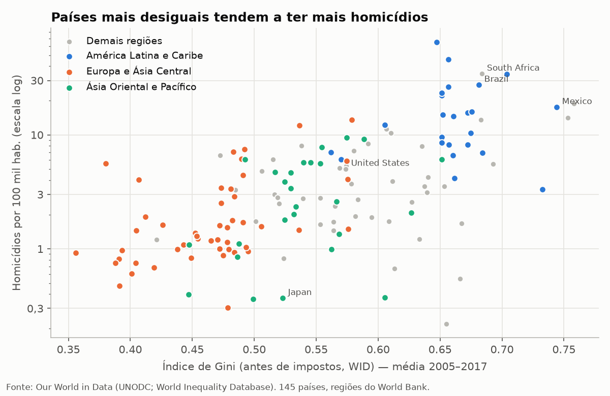
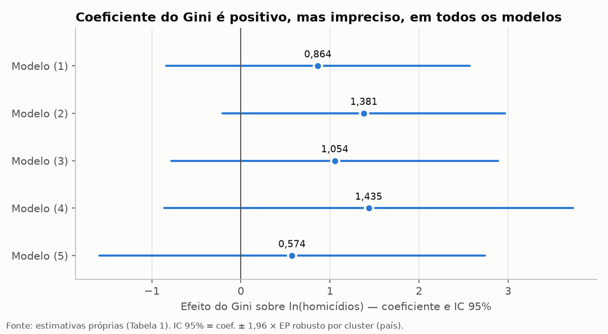
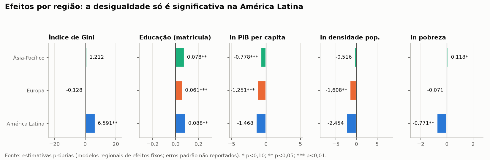

# Desigualdade de renda e homicídios: evidências com dados em painel

Este estudo econométrico investiga se a **desigualdade de renda (índice de Gini)** está associada a **taxas de homicídio mais altas**. Usa um painel de cerca de 145 países entre 2005 e 2017, regressão múltipla com **efeitos fixos de país** e erros padrão robustos agrupados por país.

Trabalho desenvolvido na disciplina **Econometria I** do curso de Ciências Econômicas da **Universidade Federal de Alagoas (UFAL)**, em 2025.

📄 **Relatório completo:** [`relatorio/relatorio.pdf`](relatorio/relatorio.pdf)



## Principais resultados

| | Resultado |
|---|---|
| **Gini → homicídios (painel completo)** | Coeficiente positivo nos 5 modelos (0,574 a 1,435), significativo apenas no Modelo 2 (1,381, p < 0,10) |
| **Gini na América Latina** | 6,591 (p < 0,05): +0,01 no Gini ≈ +6,6% de homicídios |
| **Gini na Europa e na Ásia-Pacífico** | Não significativo |
| **PIB per capita (log)** | Negativo e significativo a 1% (−1,274 e −0,856) |
| **Matrícula escolar e densidade populacional** | Sinais contrários aos esperados, o que pede cautela |



**Por que o efeito do Gini é impreciso?** Somente **3,1% da variância do Gini** ocorre dentro dos países ao longo do tempo. Os efeitos fixos usam apenas essa parte da variação. Por isso o sinal é o esperado, mas os erros padrão são grandes. A seção 5 do relatório compara os resultados com a literatura:

| Resultado | Autores que corroboram |
|---|---|
| Associação positiva entre Gini e homicídios | Krahn, Hartnagel e Gartrell (1986); Fajnzylber, Lederman e Loayza (2002a; 2002b); Nadanovsky e Cunha-Cruz (2009) |
| Efeito perde significância com efeitos fixos de país | Neumayer (2003; 2005); Brush (2007) |
| Efeito forte na América Latina, nulo na Europa | Silva e Lozano (2022); Enamorado et al. (2016); Nadanovsky e Cunha-Cruz (2009) |
| PIB per capita reduz homicídios | Neumayer (2003) |



## Estrutura do repositório

```
├── codigo/
│   ├── stata/codigos.do              # preparação dos dados (original, Stata)
│   └── python/
│       ├── preparacao_dados.py       # versão Python do codigos.do (gerada com IA)
│       ├── verificacao_modelo1.py    # reestimação independente do Modelo 1 (gerada com IA)
│       ├── figuras.py                # gráficos do relatório (gerado com IA)
│       └── gerar_relatorio.py        # monta o PDF (gerado com IA)
├── dados/
│   └── README.md                     # onde baixar cada base (os dados não são versionados)
├── figuras/                          # gráficos em PNG
├── relatorio/relatorio.pdf
└── requirements.txt
```

## Como reproduzir

1. Baixe as bases listadas em [`dados/README.md`](dados/README.md) e salve-as em `dados/brutos/` com os nomes indicados.
2. Preparação dos dados, por um dos dois caminhos:
   - **Stata:** ajuste o `cd` no início de `codigo/stata/codigos.do` e rode o arquivo;
   - **Python:** `pip install -r requirements.txt` e depois `python codigo/python/preparacao_dados.py`.
3. Gráficos e relatório: `python codigo/python/figuras.py` e depois `python codigo/python/gerar_relatorio.py`.
4. Checagem do Modelo 1: `python codigo/python/verificacao_modelo1.py`.

## Sobre o uso de Inteligência Artificial

A análise econométrica original foi feita em **Stata** (`codigo/stata/codigos.do`), e as estimações estão no relatório. Os scripts em **Python** foram **gerados com auxílio de IA (Claude, da Anthropic)** a partir do do-file original, para facilitar a reprodução por quem não usa Stata. O mesmo vale para os gráficos e a diagramação do PDF. Todos os coeficientes do relatório vêm das estimações originais em Stata; nenhum número foi gerado pela IA. A única exceção é a verificação independente do Modelo 1, que está identificada como tal.

## Verificação de reprodutibilidade

| | Relatório (Stata) | Reestimação (Python) |
|---|---|---|
| Coeficiente do Gini | 0,864 (0,869) | 0,867 (0,863) |
| Constante | 0,620 | 0,617 |
| Observações | 1044 | 1048 |

A pequena diferença é compatível com atualizações das bases do Our World in Data. Os Modelos 2 a 5 dependem de bases (matrícula, democracia, pobreza e gasto em educação) cujos arquivos brutos não foram preservados.

## Observações sobre o código e os dados

- O arquivo `pop_prisional.xls` baixado contém o indicador de **desemprego** (SL.UEM.TOTL.NE.ZS), e não população prisional.
- O do-file cobre apenas a preparação das bases; as etapas de junção e estimação estão descritas no relatório.

## Referências

- BRUSH, J. Does income inequality lead to more crime? A comparison of cross-sectional and time-series analyses of United States counties. *Economics Letters*, v. 96, n. 2, p. 264–268, 2007.
- ENAMORADO, T.; LÓPEZ-CALVA, L. F.; RODRÍGUEZ-CASTELÁN, C.; WINKLER, H. Income inequality and violent crime: evidence from Mexico's drug war. *Journal of Development Economics*, v. 120, p. 128–143, 2016.
- FAJNZYLBER, P.; LEDERMAN, D.; LOAYZA, N. What causes violent crime? *European Economic Review*, v. 46, n. 7, p. 1323–1357, 2002a.
- FAJNZYLBER, P.; LEDERMAN, D.; LOAYZA, N. Inequality and violent crime. *The Journal of Law and Economics*, v. 45, n. 1, p. 1–40, 2002b.
- KRAHN, H.; HARTNAGEL, T. F.; GARTRELL, J. W. Income inequality and homicide rates: cross-national data and criminological theories. *Criminology*, v. 24, n. 2, p. 269–295, 1986.
- NADANOVSKY, P.; CUNHA-CRUZ, J. The relative contribution of income inequality and imprisonment to the variation in homicide rates among Developed (OECD), South and Central American countries. *Social Science & Medicine*, v. 69, n. 9, p. 1343–1350, 2009.
- NEUMAYER, E. Good policy can lower violent crime: evidence from a cross-national panel of homicide rates, 1980–97. *Journal of Peace Research*, v. 40, n. 6, p. 619–640, 2003.
- NEUMAYER, E. Inequality and violent crime: evidence from data on robbery and violent theft. *Journal of Peace Research*, v. 42, n. 1, p. 101–112, 2005.
- RIVEROS GAVILANES, J. M. On the empirics of violence, inequality, and income. *Journal of Economics & Management*, v. 45, p. 102–136, 2023.
- SILVA, J.; LOZANO, E. Análisis de las tasas de homicidio, un estudio para países latinoamericanos y europeos. *Revista Venezolana de Economía y Ciencias Sociales*, v. 10, n. 1, p. 77–93, 2022.

## Autor

**Charliton da Silva Nogueira**, graduação em Ciências Econômicas (UFAL).
